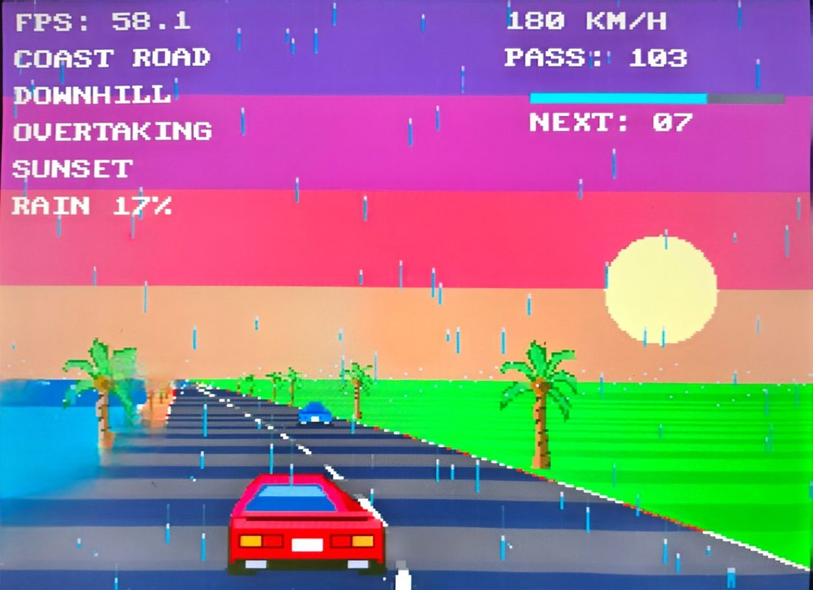

# VGA_esp32s3



*VGA Racer demo — ESP32-S3, RGB332 live palette, sprites and pseudo-3D scenery; ~58 FPS in the pictured run.*

**VGA graphics library for ESP32-S3 (Arduino IDE)** — RGB565 / 8-bit graphics, PSRAM framebuffers, indexed color palettes, sprites, text, effects, and VGA output using the ESP-IDF RGB LCD peripheral.

**Автор / Author:** Pavel SunStar  
**Лицензия / License:** [MIT](LICENSE)  
**Статус / Status:** Active experimental project. The examples in this repository have been tested by the author on real ESP32-S3 hardware; portability to other boards and Arduino-ESP32 versions is not guaranteed.

> **Русский:** Библиотека для вывода VGA-графики с ESP32-S3 через `esp_lcd_rgb_panel`. Поддерживаются 8/16-битные буферы в PSRAM, палитра RGB332→RGB565, масштабирование, примитивы, шрифты и спрайты. Ниже приведены подключение, примеры и описание актуального API.

## Features / Возможности

- ESP32-S3 VGA output via `esp_lcd_rgb_panel` and custom bounce-buffer callbacks.
- **RGB565 (16-bit)** and **8-bit** framebuffer modes.
- Optional **8-bit indexed palette**, with live `setPalCol()` updates and RGB565 output conversion.
- One or two framebuffers in external PSRAM; `swap()` synchronizes double-buffered drawing.
- Logical 640×480, 320×240 (2× output scaling), and 160×120 (4× scaling) currently implemented.
- Drawing: pixels, lines, rectangles, circles, ellipses, triangles, arcs, polygons, stars, flood fill, and blur.
- Text: built-in font, cursor printing, scaling, formatted strings, and affine text.
- `Sprite` class for image drawing, masking, and transformed sprite rendering.
- Background graphics, screen buffer access with `Buf()`, frame counter and FPS-related helpers.

## Hardware / Оборудование

- ESP32-S3 board **with PSRAM** (the project has been developed on N16R8-class hardware).
- VGA monitor.
- **Proper analog VGA RGB circuit**, e.g. an appropriately designed resistor DAC for the monitor's 75 Ω inputs, plus sync and GND connections.
- Arduino IDE with Espressif's **esp32** board package.

> **Important:** ESP32-S3 GPIO signals are digital 3.3 V signals. **Do not connect the RGB GPIO lines directly to the VGA analog inputs.** Use a correctly designed resistor network / DAC, check your wiring and common ground. The following table is the **firmware GPIO assignment**, not a complete VGA connector wiring schematic.

### Default VGA pinout / Распиновка

The defaults are defined as `defPins_S3` in [`src/structures.h`](src/structures.h).

| Signal | ESP32-S3 GPIO |
| --- | --- |
| R0, R1, R2, R3, R4 | 15, 7, 6, 5, 4 |
| G0, G1, G2, G3, G4, G5 | 14, 13, 12, 11, 10, 9 |
| B0, B1, B2, B3, B4 | 3, 8, 18, 17, 16 |
| HSYNC | 1 |
| VSYNC | 2 |

The current implementation uses these defaults internally. It does **not** expose the former `setPins()` interface from older versions of this project.

## Installation / Установка

1. Install the Arduino IDE and the Espressif **esp32** board package.
2. Select the correct ESP32-S3 board and **enable PSRAM** in the board configuration.
3. Download the repository using **Code → Download ZIP** or clone it:
   ```bash
   git clone https://github.com/PavelSunStar/VGA_esp32s3.git
   ```
4. Install the library as a ZIP or place it in your Arduino libraries folder as `VGA_esp32s3`.
5. Open one of the sketches from the [`examples/`](examples) directory and compile it.

The current public header is **`VGA_esp32.h`**, and the class is **`VGA_esp32`**.

**Compatibility note:** `library.properties` currently lists `includes=VGA_ESP32S3.h`, an older name. Until its metadata is corrected, use **`#include <VGA_esp32.h>`** explicitly (as the current examples do). This documentation update does not modify the metadata or library code.

Arduino-ESP32 version and build configuration have not yet been pinned in CI. Preserve your known-good setup when upgrading toolchains.

## Quick start / Быстрый старт

A simple **640×480 RGB565** test. The library already provides `testRGB()`:

```cpp
#include <Arduino.h>
#include <VGA_esp32.h>

VGA_esp32 vga;

void setup() {
    Serial.begin(115200);

    if (!vga.init(Mode640x480, BPP_16, false, false)) {
        Serial.println("VGA INIT ERROR!");
        return;
    }

    vga.testRGB();
}

void loop() {
    // Static RGB565 test image
}
```

### Initialization

```cpp
bool init(ScreenMode mode, ColorDepth depth, bool usePal, bool doubleBuffer);
```

| Argument | Description |
| --- | --- |
| `mode` | Logical drawing resolution, e.g. `Mode320x240` |
| `depth` | `BPP_8` or `BPP_16` |
| `usePal` | Indexed 8-bit framebuffer with RGB565 palette conversion |
| `doubleBuffer` | `true` to render into a second buffer and call `swap()`; `false` for one buffer |

**Currently implemented modes** (confirmed by `VGA_esp32::setMode()`):

| Logical framebuffer | VGA output timing | Scaling |
| --- | --- | --- |
| 640×480 | 640×480 | 1× |
| 320×240 | 640×480 | 2× |
| 160×120 | 640×480 | 4× |

Other resolution names appear in the `ScreenMode` enum, but are **not yet handled** by `setMode()` and should not be considered supported.

### Single vs double buffering

```cpp
// One framebuffer — useful for static screens and some feedback effects
vga.init(Mode320x240, BPP_16, false, false);

// Two framebuffers — for full-screen animation
vga.init(Mode320x240, BPP_16, false, true);
// ... draw a completed frame ...
vga.swap();
```

`swap()` is meaningful with double buffering enabled. A full-screen animation normally benefits from two buffers, while a static test image needs only one.

At 320×240 RGB565, one framebuffer requires **153,600 bytes**; two require **307,200 bytes**, excluding additional working buffers. A 640×480 RGB565 framebuffer requires **614,400 bytes**.

**Known issue requiring future review:** In the current source, single-buffer mode aliases `fb1` and `fb0`, while `destroy()` frees both unconditionally. Reinitialization/destruction in that mode may cause a double-free. This README does not change runtime behavior; avoid repeatedly reinitializing until that path is fixed and tested.

## Drawing API / Графические функции

The drawing methods are implemented directly on `VGA_esp32` — **no separate `VGA_GFX` object is needed**.

```cpp
vga.cls(0x0000);                    // Clear: black
vga.putPixel(10, 10, 0xFFFF);      // White pixel
vga.line(10, 20, 150, 80, 0x07E0);
vga.fillRect(20, 20, 100, 60, 0xF800);
vga.circle(160, 120, 40, 0x001F);
vga.setTextSize(2);
vga.putString(12, 12, "ESP32-S3 VGA", 0xFFFF);
```

Selected public methods:

| Area | Methods |
| --- | --- |
| Screen | `Width()`, `Height()`, `CX()`, `CY()`, `Buf()`, `BPP()` |
| Buffers | `init()`, `swap()` |
| Pixels and lines | `getPixel()`, `putPixel()`, `hLine()`, `vLine()`, `line()` |
| Shapes | `rect()`, `fillRect()`, `circle()`, `fillCircle()`, `ellipse()`, `triangle()`, `polygon()`, `star()` |
| Text | `putString()`, `putPrintf()`, `setCursor()`, `setTextColor()`, `setTextSize()`, `print()` |
| Effects | `blur()`, `floodFill()`, affine text functions |
| Palette | `setPalCol(index, r, g, b)` |
| Background | `initBG()`, `loadBG()`, `drawBG()` |
| Diagnostics | `Frame()`, `FPS()`, `ISRCore()`, `testRGB()` |

The current code also exposes `Sprite` in [`src/Sprite.h`](src/Sprite.h). See [`src/VGA_esp32.h`](src/VGA_esp32.h) for the full API.

### Palette mode

In indexed palette mode, a pixel is an 8-bit **palette index**, and the driver converts it to RGB565 during VGA output. A palette entry can be changed with:

```cpp
vga.setPalCol(1, 255, 0, 0);  // Index 1 -> red
```

This makes it possible to change visible colors without rewriting all the pixel indices.

### FPS

`Frame()` is a VGA frame counter, and `FPS()` is a library FPS helper. For **3D rendering throughput**, measure completed iterations of your drawing loop separately, as demonstrated in `Doughnut_3d`. The VGA refresh rate and the application's drawing FPS are not necessarily the same.

## Examples / Примеры

| Example | Description |
| --- | --- |
| [Mode_RGB_Test](examples/Mode_RGB_Test/Mode_RGB_Test.ino) | RGB565 color testing via built-in `testRGB()` |
| [Circles](examples/Circles/Circles.ino) | Moving colored circles with `blur()` feedback and a single framebuffer |
| [Doughnut_3d](examples/Doughnut_3d/Doughnut_3d.ino) | Animated 3D torus with Z-buffer, RGB565, performance measurements and two buffers |
| [Scroll](examples/Scroll/Scroll.ino) | Six scrolling modes using helper functions in the sketch and direct `Buf()` access |
| [GameDemo](examples/GameDemo/GameDemo.ino) | VGA Racer demo: RGB332 graphics, car/palm sprites, scenery and live palette effects |

**Note:** `Scroll` implements scrolling helpers **inside the example**; they are not public methods of the current `VGA_esp32` class. In `GameDemo`, the asset headers (`car.h`, `palm.h`, `sunset.h`) and `GameTypes.h` are part of the example and should be kept together.

## Source structure / Структура проекта

```text
VGA_esp32s3/
├── README.md
├── LICENSE
├── library.properties
├── examples/
│   ├── Mode_RGB_Test/
│   ├── Circles/
│   ├── Doughnut_3d/
│   ├── Scroll/
│   └── GameDemo/
└── src/
    ├── VGA_esp32.h
    ├── VGA_esp32.cpp
    ├── structures.h
    ├── Sprite.h
    ├── Sprite.cpp
    ├── Matrix.h
    ├── Matrix.cpp
    ├── VGA_Math.h
    ├── colorConverter.h
    ├── fonts/
    └── include/
        ├── VGA_Init.cpp
        ├── VGA_BG.cpp
        ├── VGA_Font.cpp
        ├── VGA_Palette.cpp
        └── GFX.cpp
```

## Development notes / Разработка

This project is evolving. Before adding new features or changing memory handling:

1. Save a known-good copy of your Arduino sketches and hardware configuration.
2. Work in a separate Git branch, verify on the actual monitor, then merge.
3. Keep VGA pin assignments and timing changes separate from graphics changes.
4. Record the board profile, Arduino-ESP32 core version and PSRAM settings used in tested builds.
5. Tag tested releases and keep offline backups. GitHub is not a replacement for backups of local work, PCBs, Gerbers and other design sources.

No automated CI/hardware validation is configured in this repository at the time of this README update.

## License

Released under the [MIT License](LICENSE).
